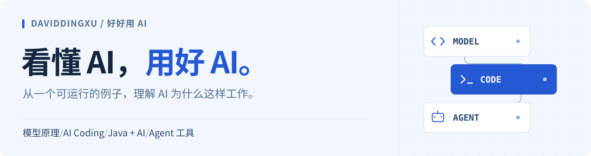

<picture>
  <source media="(max-width: 600px) and (prefers-color-scheme: dark)" srcset="assets/header-mobile-dark.svg">
  <source media="(max-width: 600px)" srcset="assets/header-mobile.svg">
  <source media="(prefers-color-scheme: dark)" srcset="assets/header-dark.svg">
  
</picture>

  <a href="#原创课程">原创课程</a> · <a href="#开源工具">开源工具</a> · <a href="https://space.bilibili.com/413766966">B 站视频</a> · <a href="#找到我">公众号</a>

你好，我是 **DavidDingXu**，一名程序员，也是公众号「**好好用 AI**」的作者。

我关注大模型原理、Agent 与 AI Coding。喜欢从一个具体问题出发，用图解、文章和能运行的代码，把原理讲清楚，把方法用到真实项目里。

## 原创课程

三套已完结课程，全文免费阅读，附配套代码与 PDF / EPUB 电子书。

**[Java AI 应用开发实战](https://daviddingxu.github.io/learn-java-ai/)** · 52 篇文章 
沿一条客户服务业务链，学习 Spring AI、企业 RAG、受控 Agent 与上线治理。 
[在线阅读](https://daviddingxu.github.io/learn-java-ai/) · [配套代码](https://github.com/DavidDingXu/learn-java-ai) · [电子书](https://daviddingxu.github.io/learn-java-ai/#downloads)

**[程序员 AI Coding 进阶实战](https://daviddingxu.github.io/learn-ai-coding/)** · 42 篇文章 
在真实代码库中，建立从上下文、规格到实现、测试与审查的个人工作流。 
[在线阅读](https://daviddingxu.github.io/learn-ai-coding/) · [配套代码](https://github.com/DavidDingXu/learn-ai-coding) · [电子书](https://daviddingxu.github.io/learn-ai-coding/#downloads)

**[AI Coding 团队化实战](https://daviddingxu.github.io/ai-coding-for-teams/)** · 14 篇文章 
把个人经验带进研发团队：共同规则、需求拆分、验证治理与协作接管。 
[在线阅读](https://daviddingxu.github.io/ai-coding-for-teams/) · [配套代码](https://github.com/DavidDingXu/ai-coding-for-teams) · [电子书](https://daviddingxu.github.io/ai-coding-for-teams/#downloads)

**新课筹备中 · [Hello LLM：手写小模型，看懂大模型](https://github.com/DavidDingXu/hello-llm)** 
从一个神经元到文字生成，用图解、代码和浏览器实验理解语言模型。

## 开源工具

### [agent-handoff](https://github.com/DavidDingXu/agent-handoff)

把 Codex / Claude Code 的真实任务会话打包成文件或端到端加密链接，在另一端导入后继续。

保留对话、工具记录与图片，支持两种工具之间的任务迁移。适用于换设备、换工具，以及与他人交接开发任务。

[查看项目与安装方式 →](https://github.com/DavidDingXu/agent-handoff#install-in-30-seconds)

更早的 Java 项目

- [springboot-socket-demo](https://github.com/DavidDingXu/springboot-socket-demo)：BIO 多线程 Socket 学习示例。
- [panda-mqtt](https://github.com/DavidDingXu/panda-mqtt)：阿里云 MQTT 服务端消息分发与同步调用。
- [rpc](https://github.com/DavidDingXu/rpc)：手写一个简单的 RPC 框架。

## 找到我

**微信公众号：好好用 AI**

持续更新「AI 观察笔记」与「AI 每日一课」，分享 AI 动态、原理与实践。

[B 站 · 好好用AI](https://space.bilibili.com/413766966) · [微信公众号](https://mp.weixin.qq.com/mp/profile_ext?action=home&__biz=MzYzNTkzMDY0NA==)

课程勘误与工具问题，欢迎到对应仓库提交 Issue。

 
